# Iris : entraîner un modèle, puis compter ses prédictions avec Redis

```
exercice-docker/
├── train/                         entraînement du modèle
├── infer/                         prédiction, puis API
├── docker-compose.entrainement.yml
├── docker-compose.yml             TP 4 : api + Redis
├── captures/                      les preuves, une image par étape
└── README.md
```

Ce dépôt fait deux choses.

1. Il entraîne un modèle qui reconnaît une fleur iris, et il le range dans une image Docker.
2. Il expose ce modèle dans une API. Chaque fois que quelqu'un demande une prédiction, Redis ajoute 1 à un compteur.

## Lire une réponse de l'API

Un appel à `/predict` renvoie deux informations différentes :

```json
{"espece":"setosa","mesures":[5.1,3.5,1.4,0.2],"predictions":4}
```

| Champ | Ce que c'est |
|---|---|
| `mesures` | Les 4 tailles de la fleur, en centimètres : sépale et pétale. |
| `espece` | La **prédiction**. Le modèle regarde les mesures et répond quelle espèce c'est. Ici, `setosa`. |
| `predictions` | Le **compteur**. Ce n'est pas l'espèce. C'est le nombre de fois où l'on a appelé `/predict`. |

`/stats` ne devine rien. Il relit seulement le compteur :

```json
{"predictions":4}
```

Ce compteur vit dans Redis, sur un volume Docker nommé `redis-data`.

- `docker compose down` arrête les conteneurs et **garde** le volume. Au redémarrage, le compteur vaut encore 4.
- `docker compose down -v` arrête les conteneurs et **supprime** le volume. Au redémarrage, le compteur vaut 0. Le modèle, lui, est toujours là : un nouvel appel à `/predict` répondra encore `setosa`, et le compteur repartira à 1.

## Partie 1. Le modèle, déjà conteneurisé

Le dossier de départ contient l'entraînement, l'inférence et le Compose qui les enchaîne.

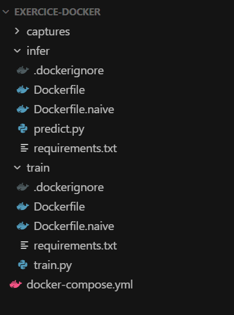

`train/train.py` apprend sur le jeu de données iris (150 fleurs, 4 mesures, 3 espèces) et enregistre `iris_model.joblib` dans le volume monté sur `/model`.

`infer/predict.py` charge ce fichier. Sans argument, il utilise une fleur connue, une setosa : `5.1, 3.5, 1.4, 0.2`.

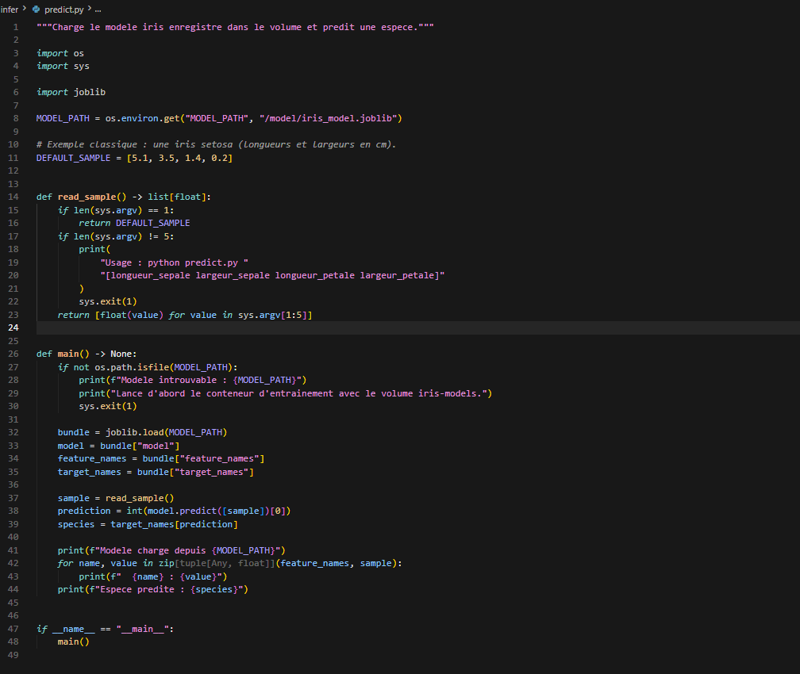

L'image d'inférence est la version optimisée : base `python:3.11-slim`, installation des dépendances dans une première étape, puis copie du seul résultat dans l'image finale.

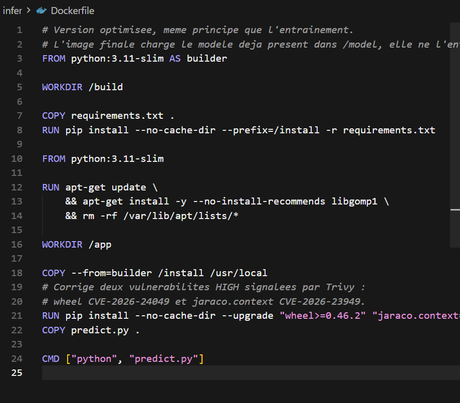

| Version | Taille | Build à froid | Build à chaud |
|---|---:|---:|---:|
| Naïve, `python:3.11` | 1,98 GB | entraînement 53 s, inférence 76 s | environ 2 s |
| Optimisée, `python:3.11-slim` | 559 MB | entraînement 65 s, inférence 62 s | environ 2 s |

L'image est environ 3,5 fois plus petite. Le premier build reste long parce que NumPy, SciPy et scikit-learn sont encore téléchargés. Le fichier d'enchaînement entraînement puis inférence est conservé dans `docker-compose.entrainement.yml`.

Trivy ne trouvait aucune faille critique. Deux failles hautes venaient de copies anciennes de `wheel` (CVE-2026-24049) et `jaraco.context` (CVE-2026-23949), embarquées par `setuptools`. Les Dockerfiles installent désormais `wheel` 0.48.0, `jaraco.context` 6.1.0 et `setuptools` 84.0.0. Un nouveau scan ne signale plus de faille haute ni critique sur les paquets Python.

## Partie 2. TP 4, l'API et Redis

### L'API

`infer/api.py` reprend la même prédiction et la publie sur le port 8000. `/predict` devine l'espèce puis fait `INCR` dans Redis. `/stats` lit la clé `predictions`.

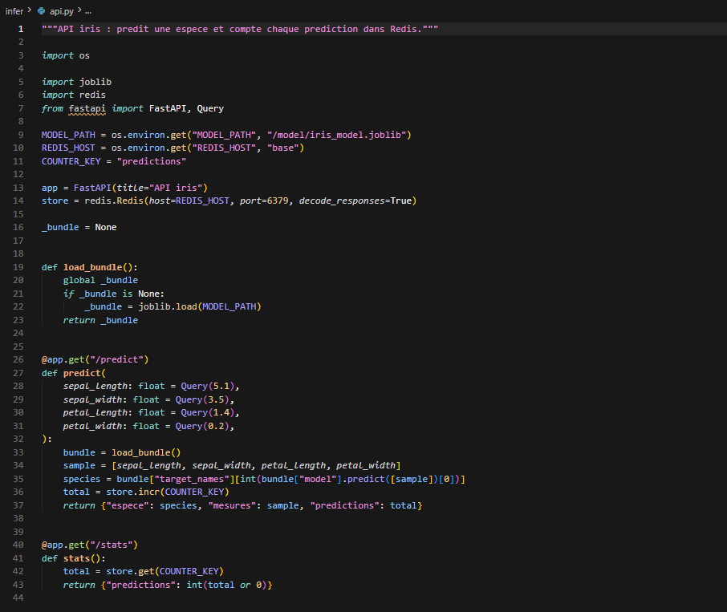

### Les deux services

`docker-compose.yml` décrit le couple demandé par le TP.

- `api` construit `./infer`, publie `8000:8000`, et monte le volume du modèle déjà entraîné.
- `base` est `redis:7-alpine`. Son dossier `/data` est le volume `redis-data`.

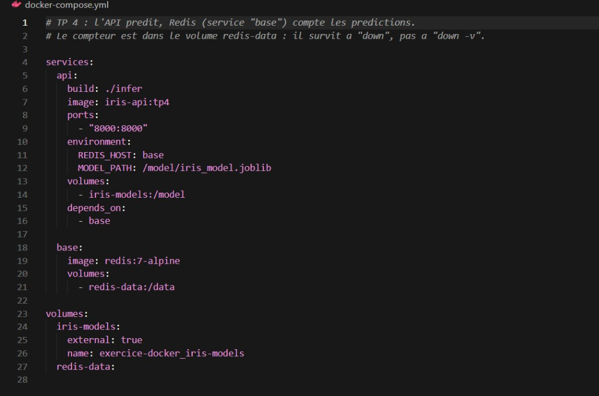

`docker compose config` relit ce fichier et confirme le port publié et le volume externe du modèle.

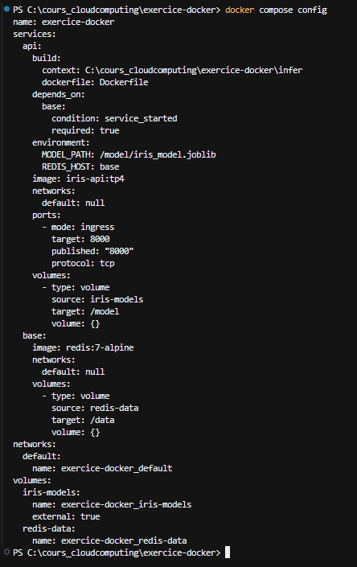

### Le premier démarrage échoue, le second passe

`docker compose up --build` télécharge Redis, puis pip 24.0 (celui de l'image de base) refuse un paquet : le fichier reçu n'a pas le hash annoncé.

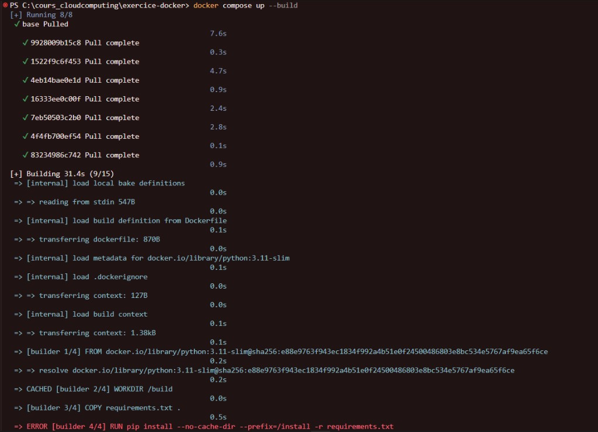

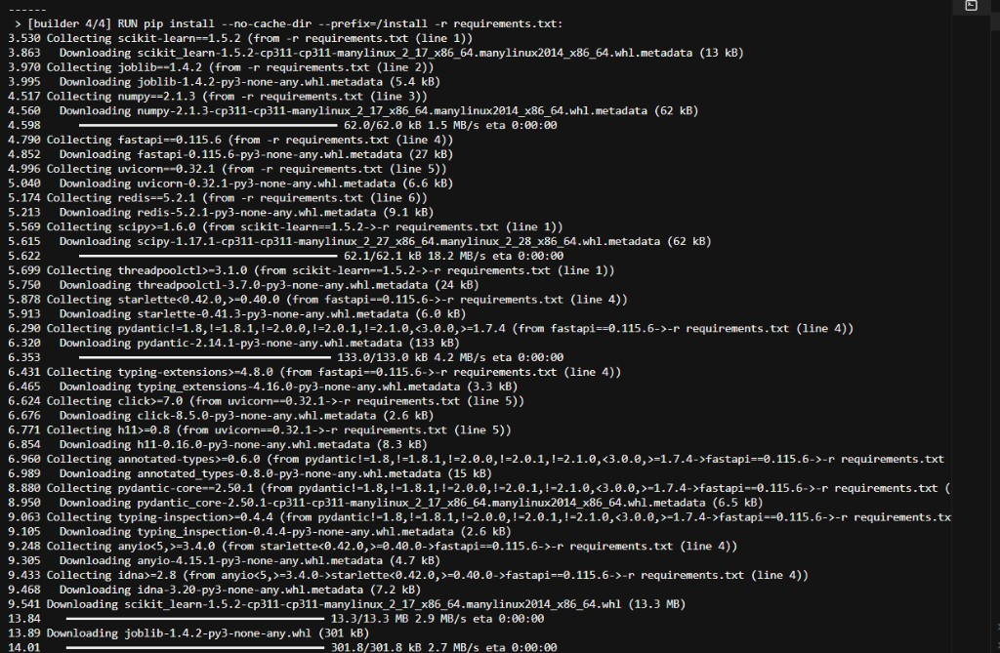

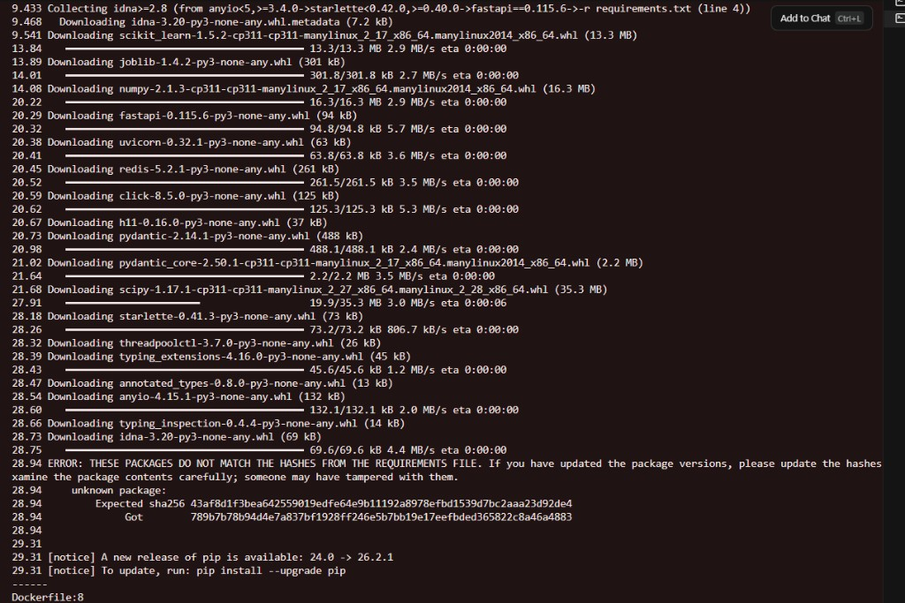

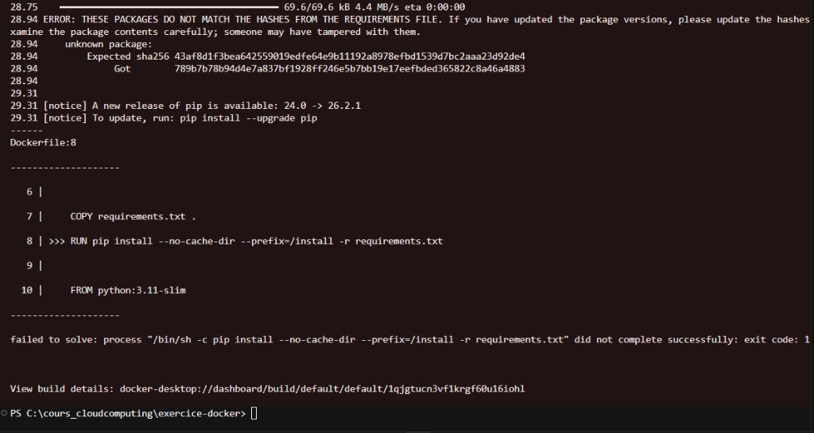

Le Dockerfile met pip à jour (`pip==26.2.1`) avant d'installer `requirements.txt`. Le build suivant est en cache, Redis démarre, et Uvicorn écoute sur le port 8000.

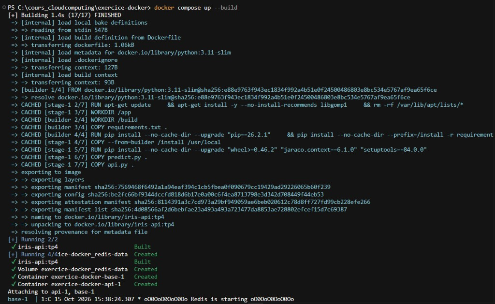

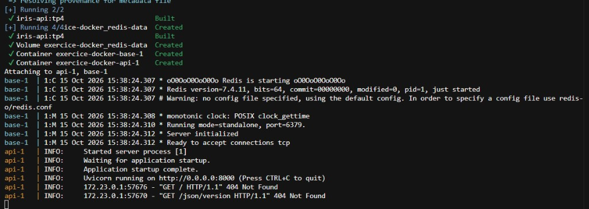

Les lignes `404` sur `/` et `/json/version` viennent d'une sonde automatique. Ces adresses n'existent pas. Les vraies adresses sont `/predict` et `/stats`.

### Plusieurs prédictions, puis le total

Firefox ouvrait `/predict` sur une page blanche. L'API avait pourtant répondu `200`.

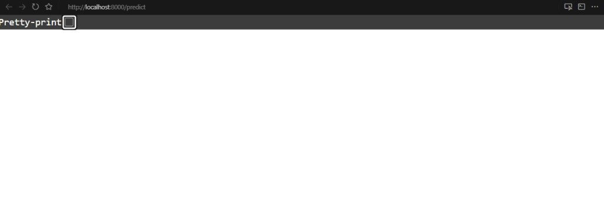

`curl.exe` affiche le JSON. Deux appels de suite donnent la même espèce, **setosa**, et le compteur passe de 3 à 4. `/stats` confirme `{"predictions":4}`.

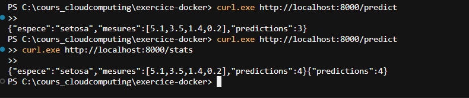

### Le compteur survit à un arrêt

`docker compose down`, puis `docker compose up`. Sans nouvel appel à `/predict`, `/stats` vaut encore 4. Dans les logs, Redis recharge son fichier : `keys loaded: 1`.

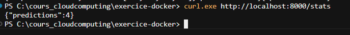

### Le compteur disparaît avec le volume

`docker compose down -v` affiche `Volume exercice-docker_redis-data Removed`. Au `up` suivant, Redis ne recharge aucune clé. `/stats` vaut 0.

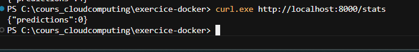

C'est le résultat attendu. `0` veut dire « personne n'a encore demandé de prédiction depuis la suppression du volume ». L'espèce `setosa` n'a pas été effacée.

## Relancer

Sur cette machine, le modèle est déjà dans le volume Docker `exercice-docker_iris-models`. Ce volume n'est pas dans Git : un modèle entraîné ne se commit pas.

```powershell
docker compose up --build
curl.exe http://localhost:8000/predict
curl.exe http://localhost:8000/stats
```

Arrêt en gardant le compteur : Ctrl+C, puis `docker compose down`. Arrêt en effaçant le compteur : `docker compose down -v`.

Sur une autre machine, il faut d'abord produire le modèle, puis brancher l'API dessus :

```powershell
docker compose -f docker-compose.entrainement.yml up
docker volume ls
```

Le nom affiché pour le volume des modèles doit être celui écrit dans `docker-compose.yml` (`exercice-docker_iris-models`). S'il diffère, on aligne la ligne `name:` avant `docker compose up --build`.
